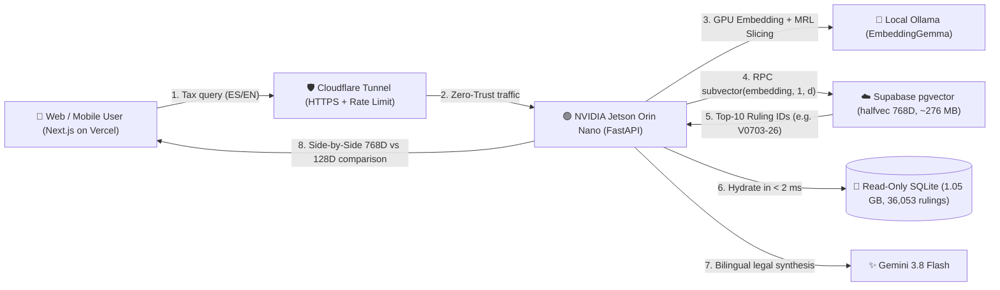

# 🪆 hacienda-ESP-rag — Matryoshka Legal RAG over 36,053 Spanish Binding Tax Rulings

<p align="center">
  <a href="#-english-documentation"><strong>🇬🇧 Read in English</strong></a> · 
  <a href="#-documentación-en-español"><strong>🇪🇸 Leer en Español</strong></a> · 
  <a href="https://hacienda.mezapps.com"><strong>🚀 Live App (ES/EN)</strong></a> · 
  <a href="https://api-hacienda.mezapps.com/docs"><strong>📘 Live API Docs (Swagger)</strong></a> · 
  <a href="https://www.cv.manuelmezo.com/hacienda-rag-project.html"><strong>📖 Technical Case Study</strong></a>
</p>

---

<a id="-english-documentation"></a>

# 🇬🇧 English Documentation

> **An open-source production Legal RAG & Matryoshka Representation Learning (MRL) benchmark by [Manuel Mezo](https://www.cv.manuelmezo.com)**  
> Live interactive demonstration of how to cut **vector database RAM consumption by 83.3%** (`768D → 128D`) while preserving legal retrieval accuracy over **36,053 official Spanish Binding Tax Rulings** (*Consultas Vinculantes de la Dirección General de Tributos*, 2016–2026, **1.05 GB**), combining **Google EmbeddingGemma**, **Supabase (`pgvector` `halfvec`)**, and **sub-2ms Local SQLite Hydration** running 24/7 on an **NVIDIA Jetson Orin Nano**.

### 🌐 Live Production Links
* 🚀 **Interactive Web Benchmark (ES / EN):** **[https://hacienda.mezapps.com](https://hacienda.mezapps.com)** *(Vercel Mirror: [hacienda-esp-rag-q7xl.vercel.app](https://hacienda-esp-rag-q7xl.vercel.app))*
* 📖 **Engineering Deep-Dive Case Study:** **[https://www.cv.manuelmezo.com/hacienda-rag-project.html](https://www.cv.manuelmezo.com/hacienda-rag-project.html)**
* 📘 **Interactive API Documentation (Swagger UI):** **[https://api-hacienda.mezapps.com/docs](https://api-hacienda.mezapps.com/docs)**
* 📕 **OpenAPI Technical Reference (ReDoc):** **[https://api-hacienda.mezapps.com/redoc](https://api-hacienda.mezapps.com/redoc)**
* 🏛️ **Official Data Source:** **[Spanish Ministry of Finance — DGT (PETETE)](https://petete.tributos.hacienda.gob.es/consultas)**

---

## 🎯 Why Does This Project Exist?

Moving from a toy RAG prototype over 10 PDFs to a real legal corpus of **36,053 multi-page tax rulings (1.05 GB of raw legal text)** immediately hits two production bottlenecks:

1. **The Vector RAM Wall:** Vector databases keep embeddings in memory for fast similarity search. Storing hundreds of thousands of `768`- or `1536`-dimensional `float32` vectors quickly consumes gigabytes of RAM and blows past cloud free tiers (such as Supabase's 500 MB limit) into \$70–\$150/month managed instances.
2. **The Cloud Text Storage Wall:** Uploading over 1 GB of full-text legal documents into a managed cloud vector database is unnecessarily expensive when the cloud index is only needed to discover **which official ruling ID (`Vxxxx-xx`)** answers the user's question.

This project solves both problems and lets you test the trade-offs live, executing **Side-by-Side** retrieval and LLM legal synthesis comparing the full **768D vector** against **Matryoshka-sliced vectors (`128D`, `256D`, `512D`)** in real time.

---

## 🧠 Core Architectural Innovations

### 1. Grounded Legal RAG with Zero Hallucinations
Standard LLMs frequently hallucinate repealed tax articles or confuse general statutes with binding administrative doctrine. Our 3-step pipeline ensures strict legal grounding:
1. **Semantic Retrieval (`Top-K = 10`):** Embeds the user's tax scenario on GPU and retrieves the **10 most relevant official Binding Tax Rulings** (deduplicated by `num_consulta`).
2. **Sub-2ms Local Hydration:** Fetches the complete, unabridged official text of those 10 rulings from local NVMe storage in `< 2 ms`.
3. **Bilingual Grounded Synthesis (ES / EN):** **Gemini 3.8 Flash** synthesizes a structured legal opinion (in **Spanish 🇪🇸** or **English 🇬🇧**) strictly grounded in the retrieved rulings, rendering clickable citation badges (`📄 V0703-26`) that open the full official DGT document in a modal.

---

### 2. Matryoshka Representation Learning (MRL) — The "Russian Doll" Effect 🪆
In conventional embedding models, semantic information is distributed uniformly across all 768 coordinates—truncating the vector destroys its meaning.

Models trained with **Matryoshka Representation Learning (MRL)**—such as Google's **EmbeddingGemma**—organize semantic information hierarchically like nested **Russian dolls**:
* Multi-scale nested loss functions force the neural network to pack **coarse, high-variance legal concepts into the earliest dimensions** (`1..128`) and progressive syntactic nuances into later dimensions (`129..768`).
* At query time, we apply **dynamic prefix slicing (`vector[:d]`) + L2 hypersphere re-normalization (`‖v‖₂ = 1`)** without re-indexing the database:

| Mode | Active Dimensions | Size per Vector (`halfvec` / `float16`) | Vector RAM Saved | Typical Retrieval Quality |
| :--- | :---: | :---: | :---: | :---: |
| **Standard RAG (Baseline)** | `768D` (100%) | `1,536 Bytes` | 0% (Baseline) | 100% |
| **Matryoshka High** | `512D` (67%) | `1,024 Bytes` | **-33.3% RAM** | ~98% |
| **Matryoshka Medium** | `256D` (33%) | `512 Bytes` | **-66.7% RAM** | ~95% |
| **Matryoshka Ultra-Compact** | **`128D` (17%)** | **`256 Bytes`** | **-83.3% RAM** | **~85% – 100%** |

---

### 3. Hybrid Edge + Cloud "Local Hydration" Pattern (0 MB Text in the Cloud)
Instead of paying for large cloud database instances to host **1.05 GB** of raw text, we decouple the **lightweight mathematical vector index** from **cold text storage**:



* **In the Cloud (Supabase Free Tier):** Stores **zero bytes of legal text**—only a single `halfvec(768)` (`float16`) vector per chunk and the ruling identifier `num_consulta` (`Vxxxx-xx`), occupying **~276 MB total** (fitting comfortably inside the 500 MB Free Tier) and executing `subvector(embedding, 1, match_dimensions)` dynamically in SQL.
* **At the Edge (NVIDIA Jetson Orin Nano 24/7):** Computes GPU embeddings via Ollama, hydrates full 15-page rulings in `< 2 ms` from local `consultas_vinculantes.db` (opened in strict OS read-only mode `?mode=ro`), and exposes the API safely via **Cloudflare Zero Trust Tunnel** with zero open router ports.

---

## 🔒 Production Security & Edge Hardening

* **Zero Local Network Exposure:** All traffic is routed through a **Cloudflare Named Tunnel** (`https://api-hacienda.mezapps.com`) with end-to-end TLS/HTTPS and DDoS mitigation.
* **Dual Sliding-Window IP Rate Limiter (`CF-Connecting-IP`):** Enforces **10 requests/minute** and **200 requests/day (24h)** per real client IP to protect the Jetson's shared GPU memory and LLM API quota.
* **Immutable SQLite (`?mode=ro`) & Input Validation:** Read-only file descriptor locking at the SQLite driver level and strict Pydantic validation (`max_length=1500`).
* **Anti-Prompt Injection Sandboxing:** Structural XML isolation (`<user_query>` / `<dgt_context>`) inside the system prompt prevents instruction-override attacks.

---
---

<a id="-documentación-en-español"></a>

# 🇪🇸 Documentación en Español

> **Un proyecto de ingeniería IA en producción y laboratorio educativo open-source por [Manuel Mezo](https://www.cv.manuelmezo.com)**  
> Demostración práctica en vivo de cómo reducir en un **83,3% el consumo de memoria RAM** en bases de datos vectoriales manteniendo la precisión de recuperación jurídica, combinando **Matryoshka Representation Learning (MRL)**, una **NVIDIA Jetson Orin Nano** en el Edge y **Supabase (`pgvector`)** en la nube sobre **36.053 Consultas Vinculantes oficiales** de la Dirección General de Tributos (2016–2026).

### 🌐 Enlaces en Vivo (Live Production)
* 🚀 **Aplicación Web Interactiva (ES / EN):** **[https://hacienda.mezapps.com](https://hacienda.mezapps.com)** *(Mirror Vercel: [hacienda-esp-rag-q7xl.vercel.app](https://hacienda-esp-rag-q7xl.vercel.app))*
* 📖 **Caso de Estudio Técnico Detallado:** **[https://www.cv.manuelmezo.com/hacienda-rag-project.html](https://www.cv.manuelmezo.com/hacienda-rag-project.html)**
* 📘 **Documentación Interactiva de la API (Swagger UI):** **[https://api-hacienda.mezapps.com/docs](https://api-hacienda.mezapps.com/docs)**
* 📕 **Especificación Técnica OpenAPI (ReDoc):** **[https://api-hacienda.mezapps.com/redoc](https://api-hacienda.mezapps.com/redoc)**
* 🏛️ **Fuente de Datos Oficial:** **[Dirección General de Tributos — Ministerio de Hacienda (PETETE)](https://petete.tributos.hacienda.gob.es/consultas)**

---

## 🎯 ¿Cuál es el objetivo de este proyecto?

Cuando pasas de construir un prototipo RAG con 10 PDFs a un corpus jurídico real con **36.053 documentos extensos** (**1,05 GB** de texto legal), aparecen dos cuellos de botella inmediatos:

1. **El coste de la Memoria RAM Vectorial:** Las bases de datos vectoriales mantienen los vectores en memoria RAM para buscar rápido. Almacenar cientos de miles de vectores completos de `768` o `1536` dimensiones en `float32` dispara el consumo de RAM y desborda las capas gratuitas en la nube (como el límite de 500 MB de Supabase).
2. **El coste de almacenar texto pesado en la nube:** Subir gigabytes de leyes completas a una base de datos vectorial gestionada es innecesariamente costoso si solo necesitas el índice vectorial para descubrir **qué resolución oficial (`Vxxxx-xx`)** responde a la duda del usuario.

Este laboratorio resuelve ambos problemas de forma visual e interactiva, comparando en tiempo real y **Side-by-Side** el Top 10 de resoluciones recuperadas por el vector completo (`768D`) frente al vector recortado con **Matryoshka (`128D`, `256D`, `512D`)**.

---

## 📚 Conceptos Clave Explicados de Forma Sencilla

### 1. ¿Qué es un RAG Legal (Retrieval-Augmented Generation)?
Un LLM generalista puede inventar artículos o leyes derogadas (*alucinaciones*). Este sistema **RAG** garantiza rigor jurídico en 3 pasos:
1. **Retrieval (Búsqueda Semántica):** Convierte la pregunta del ciudadano o asesor en un vector numérico y localiza las **10 Consultas Vinculantes oficiales** (`k = 10`, deduplicadas por `num_consulta`) más afines al caso planteado.
2. **Hidratación Local:** Extrae el texto oficial íntegro de esas 10 resoluciones desde almacenamiento NVMe local en `< 2 ms`.
3. **Generation (Síntesis con Citas Verificables):** **Gemini 3.8 Flash** redacta una conclusión jurídica estructurada (en **Español 🇪🇸** o **Inglés 🇬🇧**) basándose **exclusivamente** en las consultas recuperadas y generando chips interactivos (`📄 V0703-26`) que abren la resolución oficial completa.

---

### 2. ¿Qué es Matryoshka Representation Learning (MRL)? 🪆
En un modelo de embeddings convencional, la semántica se reparte de forma uniforme entre sus 768 dimensiones: si truncas el vector, destruyes su significado.

Los modelos entrenados con **Matryoshka Representation Learning (MRL)** —como **EmbeddingGemma** de Google— organizan la información como una **muñeca rusa**:
* Durante el entrenamiento, la función de pérdida obliga a concentrar **los conceptos nucleares en las primeras coordenadas del vector** (las primeras 128 dimensiones) y delegar los matices finos hacia el final (`129..768`).
* Esto permite aplicar **truncado dinámico en caliente (`vector[:d]`) + re-normalización L2 (`‖v‖₂ = 1`)** en tiempo de consulta:

| Modo | Dimensiones Activas | Peso por Vector (`halfvec` / `float16`) | Ahorro de RAM Vectorial | Retención Típica de Calidad |
| :--- | :---: | :---: | :---: | :---: |
| **RAG Estándar** | `768D` (100%) | `1.536 Bytes` | 0% (Referencia) | 100% |
| **Matryoshka Alta** | `512D` (67%) | `1.024 Bytes` | **-33,3% RAM** | ~98% |
| **Matryoshka Media** | `256D` (33%) | `512 Bytes` | **-66,7% RAM** | ~95% |
| **Matryoshka Ultraligera** | **`128D` (17%)** | **`256 Bytes`** | **-83,3% RAM** | **~85% – 100%** |

---

### 3. Patrón de "Hidratación Local" (Edge AI + Cloud Vector Index)
En lugar de alojar el **1,05 GB** de texto en la nube, la arquitectura desacopla el **índice semántico ligero** del **almacenamiento frío del texto**:

* **En la Nube (Supabase Free Tier):** Se almacena un único vector `halfvec(768)` (`float16`) por fragmento junto con el identificador `num_consulta` (`Vxxxx-xx`), ocupando **~276 MB en total** (dentro de los 500 MB gratuitos) y ejecutando `subvector(embedding, 1, match_dimensions)` en SQL.
* **En el Edge (NVIDIA Jetson Orin Nano 24/7):** Genera los embeddings en GPU local, hidrata en `< 2 ms` los textos completos desde `consultas_vinculantes.db` (abierta en modo estricto de solo lectura `?mode=ro`) y expone la API de forma segura mediante **Cloudflare Zero Trust Tunnel** sin abrir puertos en el router.

---

## 🛠️ Repository Structure / Estructura del Repositorio

```text
.
├── backend/
│   ├── main.py                  # FastAPI Orchestrator (MRL slicing, Supabase RPC, RO SQLite hydration, Rate Limit & Gemini)
│   ├── ingest_to_supabase.py    # GPU batch ingestion (batch=32) with checkpointing & contextual header injection
│   ├── supabase_schema.sql      # PostgreSQL pgvector halfvec(768) schema & dynamic subvector() match_documents RPC
│   ├── requirements.txt         # Python backend dependencies
│   └── .env.example             # Environment variable template (zero secrets)
├── frontend/
│   └── src/app/
│       ├── page.tsx             # Bilingual (ES/EN) Benchmark UI, BYOK (Gemini/OpenRouter/OpenAI), Feedback & Citation Modal
│       ├── layout.tsx           # SEO & OpenGraph metadata
│       └── icon.svg             # Custom vector Matryoshka favicon
├── merge_db.py                  # SQLite range-merge & SHA-256 deduplication utility
└── consultas_vinculantes.db     # [Git-ignored] Local SQLite corpus (1.05 GB, 36,053 Binding Tax Rulings 2016–2026)
```

---

## 👤 Author & Contact / Autor y Contacto

Designed and engineered by **Manuel Mezo**:

* 🌐 **Personal Portfolio / Web Personal:** [cv.manuelmezo.com](https://www.cv.manuelmezo.com)
* 📖 **Project Case Study / Caso de Estudio:** [cv.manuelmezo.com/hacienda-rag-project.html](https://www.cv.manuelmezo.com/hacienda-rag-project.html)
* 🚀 **Live Demo / App en Vivo:** [hacienda.mezapps.com](https://hacienda.mezapps.com)
* 💻 **GitHub:** [@manumezog](https://github.com/manumezog)
* 💼 **LinkedIn:** [linkedin.com/in/manuelmezo](https://www.linkedin.com/in/manuelmezo/)
* ✉️ **Email:** [manumezog@gmail.com](mailto:manumezog@gmail.com)
