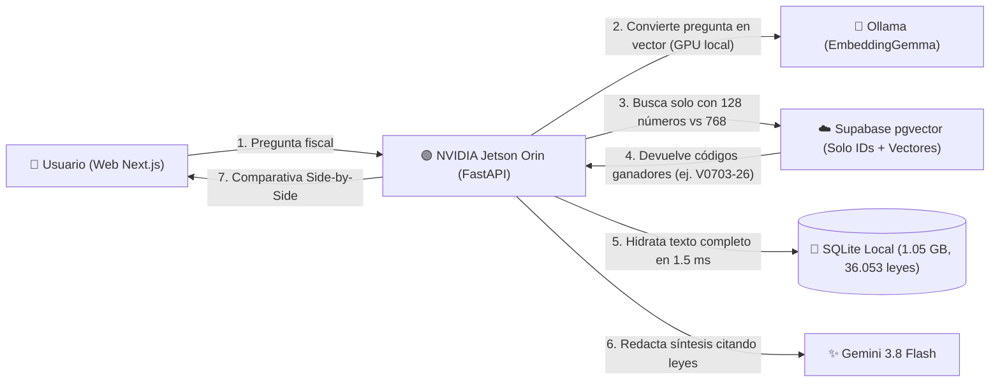

# 🪆 hacienda-ESP-rag — Aprendiendo RAG y Matryoshka Embeddings (MRL) con Datos Reales de Hacienda

> **Un proyecto educativo y experimental de código abierto por [Manuel Mezo](https://cv.manuelmezo.com)**  
> Demostración práctica de cómo reducir en un **83,3% el consumo de memoria RAM** en bases de datos vectoriales sin perder precisión legal, combinando **Matryoshka Representation Learning (MRL)**, una **NVIDIA Jetson Orin Nano** en local y **Supabase (`pgvector`)** en la nube sobre **36.053 Consultas Vinculantes** de la Dirección General de Tributos (2016–2026).

---

## 🎯 ¿Cuál es el objetivo educativo de este proyecto?

Cuando alguien empieza a construir sistemas de Inteligencia Artificial con documentos propios (**RAG**), suele encontrarse con dos grandes problemas al pasar de un tutorial de 10 PDFs a una base de datos real con **decenas de miles de documentos largos** (más de 1 GB de texto):

1. **El coste de la Memoria RAM Vectorial:** Las bases de datos vectoriales necesitan mantener los vectores (listas de números) en memoria RAM para buscar rápido. Un vector estándar tiene **768 o 1.536 dimensiones**. Multiplicado por cientos de miles de fragmentos, la memoria se dispara y supera enseguida las capas gratuitas de servicios en la nube (como el límite de 500 MB de Supabase).
2. **El coste de almacenar texto pesado en la nube:** Subir gigabytes de leyes completas a una base de datos vectorial en la nube es caro e innecesario si solo necesitas la nube para saber *"qué documento habla de este tema"*.

Este proyecto resuelve ambos problemas de forma visual e interactiva para que cualquier persona pueda comprobarlo en tiempo real.

---

## 📚 Conceptos Clave Explicados de Forma Sencilla

### 1. ¿Qué es un RAG (Retrieval-Augmented Generation)?
Los modelos de lenguaje (como ChatGPT o Gemini) pueden inventar leyes o artículos (*alucinaciones*). Un sistema **RAG** evita esto en 3 pasos:
1. **Buscar (Retrieval):** Convierte tu pregunta en un vector numérico y busca en una base de datos las resoluciones oficiales de Hacienda más parecidas.
2. **Leer el documento real:** Extrae el texto oficial íntegro de esas resoluciones.
3. **Responder con pruebas (Generation):** Le entrega esas leyes al modelo de lenguaje con la orden estricta de responder **únicamente** usando esos documentos y citando su código oficial (ej. `V0703-26`).

---

### 2. ¿Qué es Matryoshka Representation Learning (MRL)? 🪆
En un modelo de embeddings tradicional, cuando conviertes un texto en una lista de **768 números**, la información del significado está repartida por igual entre los 768 números. Si borras la mitad, el vector deja de funcionar.

Los modelos entrenados con **Matryoshka Representation Learning (MRL)** —como **EmbeddingGemma** de Google— funcionan como una **muñeca rusa (Matryoshka)**:
* Obligan a la red neuronal durante el entrenamiento a colocar **los conceptos más importantes al principio del vector** (en los primeros 128 números) y dejar los matices secundarios para el final (del 129 al 768).
* Gracias a esto, podemos **cortar el vector en caliente (`vector[:128]`)** quedándonos solo con la "muñeca pequeña":

| Modo | Tamaño del Vector | Peso por Fragmento (`float16`) | Ahorro de Memoria | Retención Típica de Calidad |
| :--- | :---: | :---: | :---: | :---: |
| **RAG Tradicional** | `768 números` | `1.536 Bytes` | 0% (Base) | 100% |
| **Matryoshka Medio** | `512 números` | `1.024 Bytes` | **-33,3% RAM** | ~98% |
| **Matryoshka Compacto** | `256 números` | `512 Bytes` | **-66,7% RAM** | ~95% |
| **Matryoshka Ultraligero** | **`128 números`** | **`256 Bytes`** | **-83,3% RAM** | **~85% – 100%** |

---

### 3. ¿Qué es el Patrón de "Hidratación Local" (Edge + Cloud)?
En lugar de subir el **1,05 GB** de textos de Hacienda a Supabase (lo que rompería el límite gratuito de 500 MB en minutos), dividimos el trabajo entre un mini-servidor en casa (**NVIDIA Jetson Orin Nano**) y la nube (**Supabase**):



* **En la Nube (Supabase):** Solo guardamos el código de la consulta (`V0703-26`), la fecha y el vector en precisión media (`halfvec`). **0 MB gastados en textos largos.**
* **En Casa (SQLite en la Jetson):** Cuando Supabase nos dice *"la consulta más relevante es la `V0703-26`"*, nuestro servidor busca `V0703-26` en el archivo SQLite local en **1,5 milisegundos** ("hidratación") y recupera las 15 páginas de ley completas.

---

## 🛠️ Estructura del Proyecto

```text
.
├── backend/
│   ├── main.py                  # Servidor FastAPI (Truncado Matryoshka, RPC Supabase, Hidratación SQLite y Síntesis Gemini)
│   ├── ingest_to_supabase.py    # Ingesta por lotes GPU con inyección de cabeceras contextuales
│   ├── supabase_schema.sql      # Esquema PostgreSQL con pgvector halfvec(768) y slicing dinámico subvector()
│   ├── requirements.txt         # Dependencias de Python
│   └── .env.example             # Plantilla de configuración
├── frontend/
│   └── src/app/page.tsx         # Interfaz Educativa Side-by-Side en Next.js + Tailwind CSS
├── scraper_petete.py            # Scraper resiliente para el buscador PETETE de la DGT (Knosys)
├── merge_db.py                  # Utilidad para fusionar bases de datos SQLite recolectadas en paralelo
└── consultas_vinculantes.db     # [Ignorado en Git] Base de datos SQLite local (1.05 GB, 36.053 consultas)
```

---

## 🚀 Cómo Ejecutar el Proyecto Paso a Paso

### 1. Base de Datos Vectorial en Supabase
Crea un proyecto gratuito en [Supabase](https://supabase.com), abre el **SQL Editor** y ejecuta el archivo [`backend/supabase_schema.sql`](./backend/supabase_schema.sql).

### 2. Backend e Ingesta (En NVIDIA Jetson Orin o PC Local)
```bash
# Descargar el modelo Matryoshka en Ollama
ollama pull embeddinggemma

# Configurar el entorno de Python
cd backend
python3 -m venv venv
source venv/bin/activate
pip install -r requirements.txt
cp .env.example .env
```
Completa `SUPABASE_URL`, `SUPABASE_KEY` y `GEMINI_API_KEY` en `backend/.env` y lanza el servidor:
```bash
# Iniciar la ingesta hacia Supabase
python3 ingest_to_supabase.py

# Levantar la API en el puerto 8000
uvicorn main:app --host 0.0.0.0 --port 8000
```

### 3. Frontend Interactivo (Next.js)
```bash
cd frontend
npm install
npm run dev
```
Abre `http://localhost:3000` en tu navegador para explorar la guía educativa y comparar búsquedas en `768D` frente a `128D`, `256D` y `512D`.

---

## 👤 Autor y Contacto

Proyecto desarrollado con fines educativos y de divulgación tecnológica por **Manuel Mezo**:

* 🌐 **Web Personal / CV:** [cv.manuelmezo.com](https://cv.manuelmezo.com)
* 💻 **GitHub:** [@manumezog](https://github.com/manumezog)
* 💼 **LinkedIn:** [Manuel Mezo](https://www.linkedin.com/search/results/all/?keywords=Manuel%20Mezo)
* ✉️ **Email:** [manumezog@gmail.com](mailto:manumezog@gmail.com)
