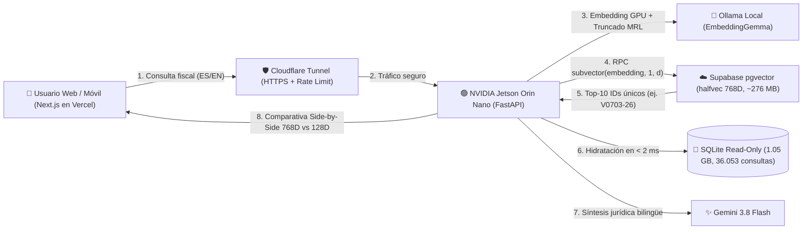

# 🪆 hacienda-ESP-rag — Buscador Fiscal IA sobre 36.053 Consultas Vinculantes de Hacienda (Matryoshka MRL)

> **Un proyecto educativo y experimental open-source por [Manuel Mezo](https://cv.manuelmezo.com)**  
> Demostración práctica en vivo de cómo reducir en un **83,3% el consumo de memoria RAM** en bases de datos vectoriales manteniendo la calidad de recuperación legal, combinando **Matryoshka Representation Learning (MRL)**, una **NVIDIA Jetson Orin Nano** en el Edge y **Supabase (`pgvector`)** en la nube sobre **36.053 Consultas Vinculantes oficiales** de la Dirección General de Tributos (2016–2026).

### 🌐 Enlaces en Vivo (Live Production)
* 🚀 **Aplicación Web Interactiva (ES / EN):** **[https://hacienda.mezapps.com](https://hacienda.mezapps.com)** *(Mirror Vercel: [hacienda-esp-rag-q7xl.vercel.app](https://hacienda-esp-rag-q7xl.vercel.app))*
* 📘 **Documentación Interactiva de la API (Swagger UI):** **[https://api-hacienda.mezapps.com/docs](https://api-hacienda.mezapps.com/docs)**
* 📕 **Especificación Técnica OpenAPI (ReDoc):** **[https://api-hacienda.mezapps.com/redoc](https://api-hacienda.mezapps.com/redoc)**
* 🏛️ **Fuente de Datos Oficial:** **[Dirección General de Tributos — Ministerio de Hacienda (PETETE)](https://petete.tributos.hacienda.gob.es/consultas)**

---

## 🎯 ¿Cuál es el objetivo educativo de este proyecto?

Cuando alguien pasa de construir un prototipo RAG con 10 PDFs a un corpus jurídico real con **36.053 documentos extensos** (**1,05 GB** de texto legal), aparecen dos cuellos de botella inmediatos:

1. **El coste de la Memoria RAM Vectorial:** Las bases de datos vectoriales mantienen los vectores en memoria RAM para buscar rápido. Almacenar cientos de miles de vectores completos de `768` o `1536` dimensiones en `float32` dispara el consumo de RAM y desborda las capas gratuitas en la nube (como el límite de 500 MB de Supabase).
2. **El coste de almacenar texto pesado en la nube:** Subir gigabytes de leyes completas a una base de datos vectorial gestionada es innecesariamente costoso si solo necesitas el índice vectorial para descubrir **qué resolución oficial (`Vxxxx-xx`)** responde a la duda del usuario.

Este laboratorio resuelve ambos problemas de forma visual e interactiva, comparando en tiempo real y **Side-by-Side** el Top 10 de resoluciones recuperadas por el vector completo (`768D`) frente al vector recortado con **Matryoshka (`128D`, `256D`, `512D`)**.

---

## 📚 Conceptos Clave Explicados de Forma Sencilla

### 1. ¿Qué es un RAG Legal (Retrieval-Augmented Generation)?
Un LLM generalista puede inventar artículos o leyes (*alucinaciones*). Este sistema **RAG** garantiza rigor jurídico en 3 pasos:
1. **Retrieval (Búsqueda Semántica):** Convierte la pregunta del ciudadano o asesor en un vector numérico y localiza las **10 Consultas Vinculantes oficiales** (`k = 10`, deduplicadas por `num_consulta`) más afines al caso planteado.
2. **Hidratación Local:** Extrae el texto oficial íntegro de esas 10 resoluciones desde almacenamiento local en `< 2 ms`.
3. **Generation (Síntesis con Citas Verificables):** **Gemini 3.8 Flash** redacta una conclusión jurídica estructurada (en **Español 🇪🇸** o **Inglés 🇬🇧**) basándose **exclusivamente** en las consultas recuperadas y generando chips interactivos (`📄 V0703-26`) que abren la resolución oficial completa.

---

### 2. ¿Qué es Matryoshka Representation Learning (MRL)? 🪆
En un modelo de embeddings convencional, la semántica se reparte de forma uniforme entre sus 768 dimensiones: si truncas el vector, destruyes su significado.

Los modelos entrenados con **Matryoshka Representation Learning (MRL)** —como **EmbeddingGemma** de Google— organizan la información como una **muñeca rusa**:
* Durante el entrenamiento, la función de pérdida obliga a concentrar **los conceptos nucleares en las primeras coordenadas del vector** (las primeras 128 dimensiones) y delegar los matices finos hacia el final (`129..768`).
* Esto permite aplicar **truncado dinámico en caliente (`vector[:d]`) + re-normalización L2 ($\|\mathbf{v}\|_2 = 1$)** en tiempo de consulta:

| Modo | Dimensiones Activas | Peso por Vector (`halfvec` / `float16`) | Ahorro de RAM Vectorial | Retención Típica de Calidad |
| :--- | :---: | :---: | :---: | :---: |
| **RAG Estándar** | `768D` (100%) | `1.536 Bytes` | 0% (Referencia) | 100% |
| **Matryoshka Alta** | `512D` (67%) | `1.024 Bytes` | **-33,3% RAM** | ~98% |
| **Matryoshka Media** | `256D` (33%) | `512 Bytes` | **-66,7% RAM** | ~95% |
| **Matryoshka Ultraligera** | **`128D` (17%)** | **`256 Bytes`** | **-83,3% RAM** | **~85% – 100%** |

---

### 3. Patrón de "Hidratación Local" (Edge AI + Cloud Vector Index)
En lugar de alojar el **1,05 GB** de texto en la nube, la arquitectura desacopla el **índice semántico ligero** del **almacenamiento frío del texto**:



* **En la Nube (Supabase Free Tier):** Se almacena un único vector `halfvec(768)` (`float16`) por fragmento junto con el identificador `num_consulta` (`Vxxxx-xx`), ocupando **~276 MB en total** (dentro de los 500 MB gratuitos) y ejecutando `subvector(embedding, 1, match_dimensions)` en SQL.
* **En el Edge (NVIDIA Jetson Orin Nano 24/7):** Genera los embeddings en GPU local, hidrata en `< 2 ms` los textos completos desde `consultas_vinculantes.db` (abierta en modo estricto de solo lectura `?mode=ro`) y expone la API de forma segura mediante **Cloudflare Zero Trust Tunnel** sin abrir puertos en el router.

---

## 🔒 Seguridad y Protección en Producción

* **Cero Exposición de Red Local:** Tráfico enrutado íntegramente a través de **Cloudflare Named Tunnel** (`https://api-hacienda.mezapps.com`) con TLS/HTTPS extremo a extremo.
* **Doble Rate Limiting por IP Real (`CF-Connecting-IP`):** Máximo **10 peticiones/minuto** y **200 peticiones/día (24h)** por IP para proteger la GPU de la Jetson y la cuota de inferencia.
* **SQLite Inmutable (`?mode=ro`) y Consultas Parametrizadas:** Conexión a base de datos en modo solo lectura a nivel de driver y validación estricta con Pydantic (`max_length=1500`).
* **Defensa Anti-Prompt Injection:** Delimitación estructural XML (`<user_query>` / `<dgt_context>`) en el prompt de sistema del LLM.

---

## 🛠️ Estructura del Repositorio

```text
.
├── backend/
│   ├── main.py                  # Orquestador FastAPI (Truncado MRL, RPC Supabase, Hidratación SQLite RO, Rate Limit y Gemini)
│   ├── ingest_to_supabase.py    # Ingesta por lotes GPU (batch=32) con checkpointing e inyección de cabeceras contextuales
│   ├── supabase_schema.sql      # Esquema PostgreSQL pgvector halfvec(768) y función RPC match_documents con subvector()
│   ├── requirements.txt         # Dependencias del backend Python
│   └── .env.example             # Plantilla de variables de entorno (sin claves)
├── frontend/
│   └── src/app/
│       ├── page.tsx             # UI Educativa Bilingüe (ES/EN), Responsive Mobile y Comparador Side-by-Side
│       ├── layout.tsx           # Metadatos SEO y OpenGraph
│       └── icon.svg             # Favicon vectorial personalizado
├── scraper_petete.py            # Scraper asíncrono resiliente para el portal PETETE de la DGT
├── merge_db.py                  # Utilidad para unificar bases de datos SQLite recolectadas en paralelo
└── consultas_vinculantes.db     # [Ignorado en Git] Corpus SQLite local (1.05 GB, 36.053 Consultas Vinculantes 2016–2026)
```

---

## 👤 Autor y Contacto

Proyecto diseñado y desarrollado por **Manuel Mezo**:

* 🌐 **Web Personal / Portfolio:** [cv.manuelmezo.com](https://cv.manuelmezo.com)
* 🚀 **Demo en Vivo:** [hacienda.mezapps.com](https://hacienda.mezapps.com)
* 💻 **GitHub:** [@manumezog](https://github.com/manumezog)
* 💼 **LinkedIn:** [linkedin.com/in/manuelmezo](https://www.linkedin.com/in/manuelmezo/)
* ✉️ **Email:** [manumezog@gmail.com](mailto:manumezog@gmail.com)
